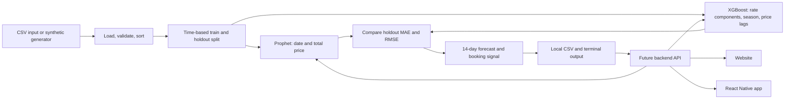

# FreightWise

FreightWise is a local proof of concept for helping Indian small and medium-sized businesses think about when to book air freight. It compares two forecasts for one lane, Shanghai to Mumbai, and turns the next week's predicted movement into a plain-English signal. The data included here is synthetic: it is for learning and testing, not for quoting a real shipment.

## Current Approach

The first version uses one daily row per date and trade lane, with base freight, fuel surcharge, a festival-season flag, and total price. The generated data has a gradual trend, ordinary seasonal movement, higher prices in October and November, and random noise. A fixed random seed makes it reproducible.

Two models are compared:

- **Prophet** sees only the date and total price. It is the time-series baseline.
- **XGBoost** sees base freight, fuel surcharge, the seasonal flag, and prices from 1, 7, 14, and 28 days earlier. It forecasts recursively, feeding each prediction into the next day.

The last 14 observed days are held out for validation. Both models are scored with mean absolute error (MAE) and root mean squared error (RMSE); lower values mean smaller average errors. For the holdout and future XGBoost forecasts, base freight and fuel surcharge are assumed to stay at their latest known values. That is a simple baseline assumption, not a market-data feed. The model with the lower holdout MAE supplies the recommendation.

## Architecture



The forecasting code is kept in a Python package so a future API can call it without either user interface needing to contain model logic. The API, website, and React Native app are roadmap items only; no server, cloud service, or external data API is used here.

## Setup

This project was prepared with Python 3.9 or newer. From the project root, create and activate a local virtual environment:

```bash
python3 -m venv .venv
source .venv/bin/activate
python -m pip install --upgrade pip
python -m pip install -r requirements.txt
python -m pip install -e .
```

The virtual environment is local and ignored by Git. The included dependencies are pandas, NumPy, Prophet, scikit-learn, and XGBoost.

## Run the Project

Generate or refresh the two-year synthetic dataset:

```bash
python -m freightwise.data_generation
```

Run the 14-day comparison and recommendation:

```bash
python -m freightwise.forecast
```

The forecast is written to `outputs/forecast.csv`; validation scores go to `outputs/metrics.json`. Both output files are intentionally local and ignored by Git. To change the input or forecast window, run `python -m freightwise.forecast --help`.

Run the small unit-test suite with:

```bash
python -m unittest discover -s tests
```

## Project Workflow Log

- **Initial proof of concept:** Created a reproducible synthetic lane dataset, Prophet and XGBoost forecasting paths, a time-based holdout comparison, and a booking recommendation. Kept all data and computation local.
- **Next update:** Record what changed, why it changed, and what was learned here whenever a project milestone is completed.

## Roadmap

1. Validate the model locally and replace synthetic values with properly sourced historical lane data.
2. Build a backend API around the shared forecasting functions.
3. Build a website that calls the backend API.
4. Build a React Native mobile app that calls the same backend API.

## Important Limitations

The sample data does not represent carrier quotes or actual Indian air-freight prices. The recommendation is a learning example, not financial or booking advice. A useful production model will need verified historical quotes, careful handling of quote dates and shipment attributes, and ongoing evaluation against a simple baseline.